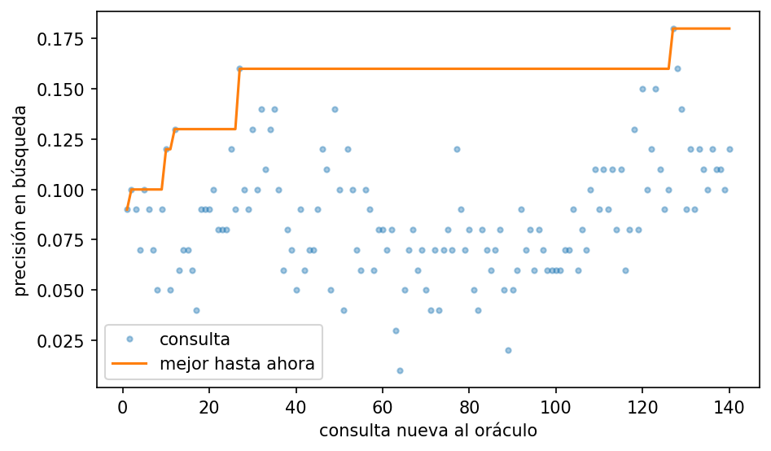
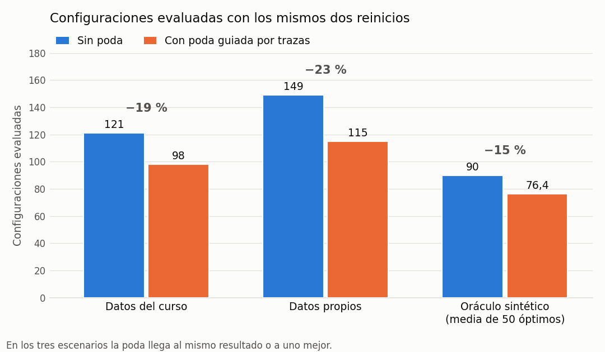

# Proyecto Oráculo · ADAG1 · Grupo G01

Análisis y Diseño de Algoritmos · 2026-B · Universidad de Caldas

**Integrantes:** Andrés Santiago Restrepo Duque · Keyla Daniela Cartagena Díaz
**Subproyecto:** ADAG1 · Proyecto Oráculo
**Versión entregada:** rama `main`, primera entrega (solución base, con resultados)

## De qué trata

Buscamos una configuración de prompt que haga que un modelo de lenguaje cumpla restricciones verificables. Una configuración tiene un índice por ranura (`rol`, `estrategia`, `formato`, `estilo`, `cierre`, con 8 opciones cada una) y una temperatura. Con la temperatura fija en 0.0 el espacio tiene 8⁵ = 32 768 configuraciones. La precisión de una configuración es la fracción de instancias que cumplen **todas** sus restricciones.

La solución base es un **ascenso por coordenadas con reinicios y poda guiada por trazas de fallos**: se cambia una ranura a la vez, y las opciones que, según las trazas, rompen instancias que otra opción resuelve se descartan de las pasadas siguientes. El resultado es la mejor configuración observada, no un óptimo demostrado.

## Resultados

Ejecución del notebook de búsqueda en Colab (GPU T4), modelo `qwen17b`, temperatura 0.0 y semilla 1, con 3 reinicios de hasta 3 pasadas.

| Dato | Valor |
|---|---|
| Configuración entregada | `rol 1, estrategia 2, formato 3, estilo 5, cierre 1, temperatura 0.0` |
| Precisión en búsqueda (100 instancias) | **18.0 %** (18/100) |
| Precisión en validación (87 instancias, `oraculo.validar`) | **12.6 %** (11/87) |
| Configuraciones evaluadas | 140 de 32 768 |
| Ahorro de la poda con los mismos reinicios | 15 % a 23 % menos configuraciones, con el mismo resultado o mejor (informe, sección 7.5) |
| Opciones descartadas por la poda | 20 (quedan 4 por ranura) |
| Tiempo de generación | ≈ 200 s por configuración no guardada en caché; 46.6 min en la última sesión (14 configuraciones) |

| Reinicio | Punto de partida | Configuración final | Precisión |
|---|---|---|---|
| 1 | (0, 0, 0, 0, 0) | (1, 4, 0, 5, 0) | 16 % |
| 2 | (2, 1, 4, 1, 7) | (0, 1, 4, 1, 0) | 12 % |
| 3 | (7, 7, 6, 3, 1) | (1, 2, 3, 5, 1) | **18 %** |

Las tuplas siguen el orden rol, estrategia, formato, estilo, cierre.



Cada punto es una configuración nueva evaluada sobre las 100 instancias de búsqueda; la línea es la mejor precisión encontrada hasta ese momento. Los escalones son las mejoras: la precisión llega a 16 % en el reinicio 1 (consulta 27) y a 18 % en el reinicio 3 (consulta 127).



Con los mismos dos reinicios, la poda guiada por trazas evalúa entre un 15 % y un 23 % menos configuraciones en los datos del curso, en los datos propios (`datos de  prueba/datos_visibles_100.json`) y en el oráculo sintético, sin empeorar el resultado. La gráfica se genera con `python pruebas/grafica_ahorro_poda.py`; el detalle está en el informe, sección 7.5.

La precisión de validación es menor que la de búsqueda porque la configuración se eligió como la mejor entre 140 sobre las mismas 100 instancias (sesgo de selección); la diferencia es de un error estándar aproximadamente. El análisis completo está en el informe, sección 7.

El notebook guardado en el repositorio se volvió a ejecutar desde la caché, por eso muestra un tiempo total casi nulo; los resultados son los mismos.

## Contenido

| Ruta | Qué es |
|---|---|
| `notebooks/01_busqueda.ipynb` | Notebook de búsqueda: método, registro de configuraciones y precisiones, análisis de trazas, poda y validación con `oraculo.validar`. Genera `entrega.json`. |
| `notebooks/02_evaluacion.ipynb` | Notebook de evaluación: carga `entrega.json` y la evalúa sobre `datos_prueba.json` sin editar código. |
| `entrega.json` | Configuración entregada (grupo, semana, índices y temperatura). Se genera al ejecutar el notebook de búsqueda. |
| `resultados/` | Evidencia de la ejecución: `evaluaciones.csv`, `registro_busqueda.json`, `derrotas.csv`, `poda.json`, `curva_busqueda.png`, `ahorro_poda.png`, `cache_oraculo.json.gz`. |
| `datos de  prueba/datos_visibles_100.json` | Datos de prueba propios: 100 instancias (40 de búsqueda, 25 de validación, 35 descartadas) con el formato de `datos_visibles.json`. |
| `docs/manual_tecnico.tex`, `docs/manual_tecnico.pdf` | Manual técnico de la solución base (fuente LaTeX y PDF compilado). |
| `docs/informe_primera_entrega.docx` | Informe académico: formalización, prueba de NP-dureza desde 3-SAT, complejidad de muestreo y resultados. |
| `pruebas/prueba_busqueda_simulada.py` | Prueba sin GPU de la heurística con un oráculo sintético (`python pruebas/prueba_busqueda_simulada.py`). |
| `pruebas/comparar_poda_sintetica.py` | Compara la búsqueda con y sin poda sobre 50 óptimos sintéticos (tabla 14 del informe). |
| `pruebas/grafica_ahorro_poda.py` | Genera `resultados/ahorro_poda.png`. |
| `oraculo.py`, `ayudas.py`, `datos_visibles.json` | Archivos del curso, sin modificar ([repo original](https://github.com/DanielMelo404/Proyecto-Oraculo-AyD)). |
| `proyecto_oraculo.ipynb` | Notebook original del curso, como referencia. |

## Requisitos

- Google Colab con GPU **T4** (el modelo `Qwen/Qwen3-1.7B` necesita CUDA).
- Python 3.10 o superior (el de Colab).
- Dependencias en `requirements.txt`; los notebooks las instalan solos. Además clonan [allenai/open-instruct](https://github.com/allenai/open-instruct), que trae los verificadores de restricciones.
- El repositorio debe ser **público** para que Colab lo pueda clonar.

## Cómo ejecutar

### Búsqueda (reproduce `entrega.json`)

1. Abrir `notebooks/01_busqueda.ipynb` en Colab (*Archivo ▸ Abrir notebook ▸ GitHub* y pegar la URL de este repositorio).
2. Elegir la GPU T4, ejecutar la sección 1 y reiniciar la sesión.
3. Ejecutar el resto en orden. La caché se guarda en Google Drive (`MyDrive/ADA_Oraculo_G01/`), así que una desconexión no pierde lo generado.
4. Al final se descarga `resultados_busqueda.zip` con `entrega.json` y la carpeta `resultados/`.

Los parámetros (semilla, pasadas, reinicios, umbral de poda) están en la sección 2. Con la misma semilla y temperatura 0.0 los resultados son los mismos.

### Evaluación

1. Abrir `notebooks/02_evaluacion.ipynb` en Colab con GPU T4.
2. Opcional: subir el archivo de prueba como `/content/datos_prueba.json`. Si no existe, se evalúa sobre la partición de validación.
3. Ejecutar la sección 1, reiniciar y ejecutar el resto. No hay que editar nada.

### Ejemplo pequeño (prueba de corrección)

Para comprobar que todo funciona sin gastar mucho tiempo de GPU, se puede evaluar una sola configuración sobre 5 instancias después de la sección 2 del notebook de búsqueda:

```python
r = oraculo.evaluar({"rol": 0, "estrategia": 0, "formato": 0, "estilo": 0, "cierre": 0,
                     "temperatura": 0.0}, busqueda[:5], semilla=1)
print(r)   # Resultado(precision=..., fallos=.../5)
```

La salida respeta las restricciones del problema si la precisión está entre 0 y 1, `r.n == 5` y cada traza tiene `id`, `violo` y `salida`.

## Formato de `entrega.json`

```json
{
 "grupo": "G01",
 "config": {"rol": 1, "estrategia": 2, "formato": 3, "estilo": 5, "cierre": 1, "temperatura": 0.0},
 "semana": 5
}
```

Cada índice va de 0 a 7 y `temperatura` es 0.0, 0.3 o 0.7. Este es el contenido del `entrega.json` del repositorio, generado por la sección 8 del notebook de búsqueda.
